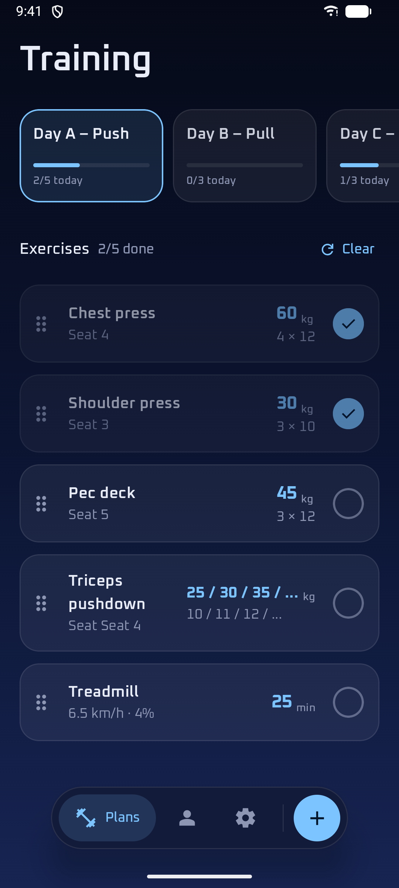
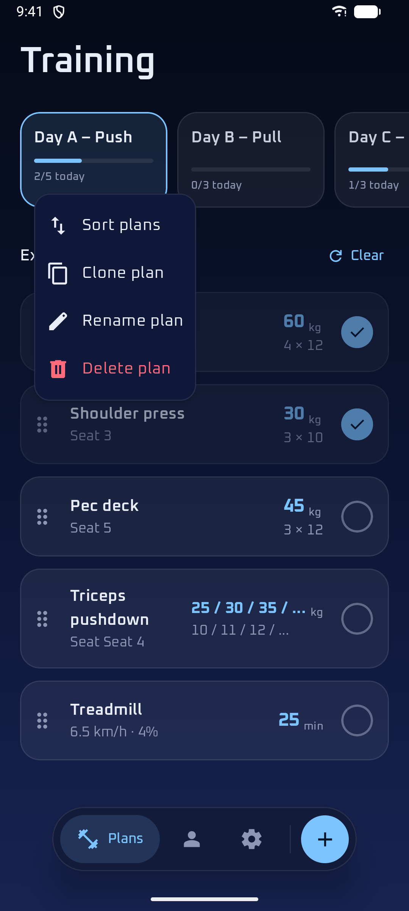
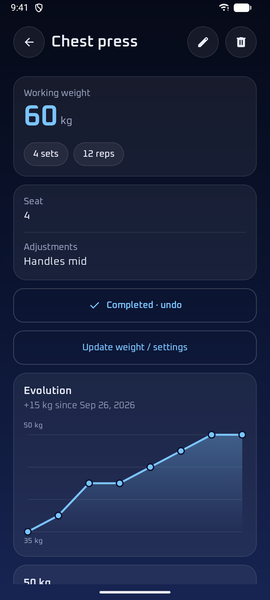
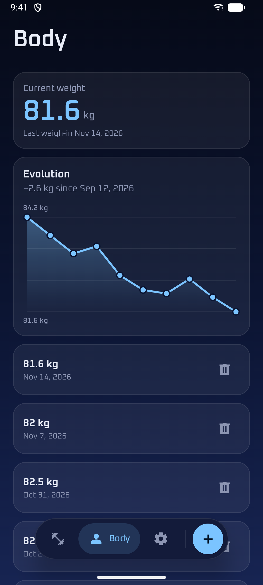
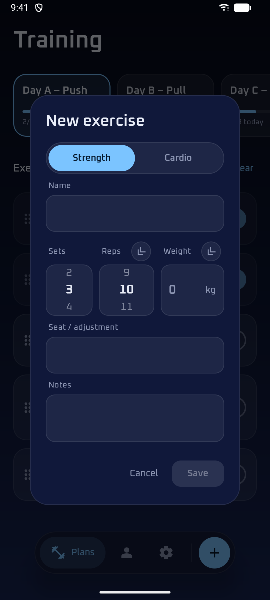
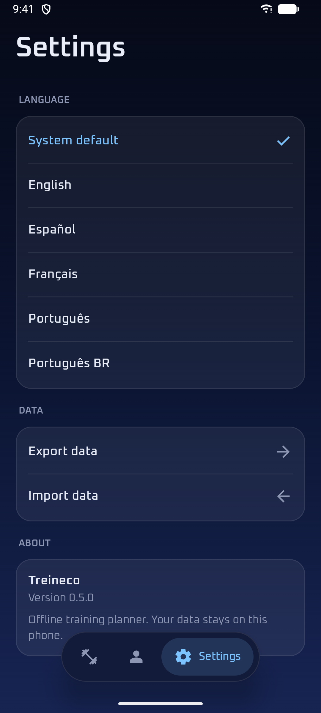

#  Treineco

Treineco is a small Android app for keeping your gym training plans on your phone: every exercise
with its sets, reps, weight, seat position and machine adjustments, so you stop relying on paper
cards, notes apps or memory between sessions. It also tracks how your working weights and your
body weight change over time.

It is a single offline app. All data stays in one file in the app's private storage on the phone —
no account, no server, no network access. Uninstalling the app or clearing its data deletes
everything.

[](docs/screenshots/overview.png)

Click a screen to open it full size. Single screens are in
[`docs/screenshots/`](docs/screenshots/) (sample data, no real records).

<table>
<tr>
<td><a href="docs/screenshots/01-plans.png"></a></td>
<td><a href="docs/screenshots/02-plan-menu.png"></a></td>
<td><a href="docs/screenshots/03-exercise.png"></a></td>
</tr>
<tr>
<td><a href="docs/screenshots/04-body.png"></a></td>
<td><a href="docs/screenshots/05-new-exercise.png"></a></td>
<td><a href="docs/screenshots/06-settings.png"></a></td>
</tr>
</table>

## Project status

- Hobby project for personal use, published as-is. No support offered: issues and pull requests
  may sit unanswered, and there are no release schedules or compatibility promises.
- Forking is not just allowed — it is the recommended path if you want changes.
- Maintained only as the author's own needs dictate.

## Features

**Plans & exercises**

- Create several training plans (e.g. "Day A", "Day B") and switch between them with cards at the
  top of the home screen; each card shows the current session's progress (`done / total`).
  Long-press a plan card to sort the plans, clone the plan (exercises included), rename or delete
  it.
- Strength exercises store sets and reps picked with scrolling number wheels, weight in kg, seat
  adjustment and other adjustments / notes.
- With more than one set, tap the arrow icon beside the Reps or Weight label (down to split, up to
  join) to set different reps or a different weight per set. Per-set cells sit in one row up to
  six sets, then wrap into rows of four.
- The training list shows the weight with its unit, and sets × reps below it. Varying reps and
  weights per set show the first three values, then `...`; open the exercise for the full list.
- Cardio exercises (treadmill, bike, …) store duration in minutes, speed / incline / level and
  notes.
- A new exercise starts with the sets, reps and weight of the last strength exercise you added.
- Drag the handle on the left of an exercise card to reorder the plan; long-press a card to edit,
  clone, clone to another plan or delete the exercise. Clones start their own weight history.
- Decimal values accept both comma and dot (`42,5` or `42.5`).

**Workout**

- Tick an exercise off with the circle on its card or the *Mark complete* button; the plan shows
  `done / total`. A plan's ticks clear automatically 24 h after its last tick, or tap *Clear* to
  reset them right away.
- A strength exercise with no weight (0 kg) shows no weight on the training list or its screen.

**Progress**

- Every change to an exercise's weight (or a cardio exercise's duration) is logged with the date
  and shown as a chart plus history list on the exercise screen.
- Body tab: log your body weight, see the current value, a chart of its evolution and the full
  history; delete wrong entries.

**App**

- Dark theme with `#7BC4FF` accents, glass-style cards, the Oxanium typeface, and a floating
  bottom bar with the add button built in.
- Settings: choose the app language — system default, English, Español, Français, Português
  (Portugal) or Português BR (Brazil) — without changing the phone's language. Numbers and dates
  follow the chosen language.
- Settings: export all data to a JSON file or import a backup, choosing the file with Android's
  file picker. Import replaces everything that is stored and asks for confirmation first; exported
  files are plain JSON, not encrypted.
- Android 8.0 (API 26) or newer.

## Install from the APK

Treineco is **not published in the Google Play Store or in any other app store.** The only
official download is the APK attached to each release on this repository's GitHub Releases page.

1. On the phone, open the Releases page in a browser and download `treineco-<version>.apk`.
2. Allow installs from that browser or file manager: *Settings → Apps → Special access →
   Install unknown apps* (the exact menu name varies by Android version).
3. Open the downloaded file and tap *Install*. If Play Protect warns about an unknown developer,
   tap *Install anyway*.
4. Open **Treineco** from the launcher.

To update, download the newer APK and install it over the old one; your data is kept. If Android
reports a conflict with the installed app (for example, the signing key differs), uninstall the
old app first. That deletes its data, so export it first in *Settings → Export data*.

## 1. Run it

Needs the Android SDK (installed with Android Studio) and JDK 17+. On macOS the `Makefile` uses
Android Studio's bundled JDK automatically when `JAVA_HOME` is not set. Gradle finds the SDK
through `ANDROID_HOME` or a `local.properties` file (`sdk.dir=/path/to/Android/sdk`, gitignored);
Android Studio creates the latter on first open.

```bash
make build   # debug APK -> app/build/outputs/apk/debug/app-debug.apk
make release # signed release APK -> app/build/outputs/apk/release/app-release.apk
make run     # install on the connected phone/emulator and launch
make test    # JVM unit tests
make lint    # Android Lint
```

To install on a phone, enable *Developer options → USB debugging*, connect it and run `make run`.
Alternatively open the folder in Android Studio and press Run.

`make release` builds a minified APK signed with the release key from
`docs/local/keystore.properties` (gitignored; it points at `docs/local/release.keystore`). Keep a
backup of both files: updates must be signed with the same key, or Android refuses to install
them over the existing app. Install it over USB with
`adb -d install -r app/build/outputs/apk/release/app-release.apk`, or copy the APK to the phone
and open it there.

### Logs

The app logs nothing of its own. Crashes show up in logcat:

```bash
adb logcat -b crash
adb logcat --pid=$(adb shell pidof gugabguerra.treineco)
```

### Data

Everything lives in `files/gym.json` inside the app's private storage, written atomically (temp
file + rename). If the file cannot be parsed on startup it is renamed to `gym.json.bad-<epoch ms>`
and the app starts empty instead of overwriting it. Settings → *Export data* writes the same JSON
to a file you choose; *Import data* replaces all data with a file in that format, and rejects
files that are not Treineco backups. On a debug build you can also copy the file out with:

```bash
adb shell run-as gugabguerra.treineco cat files/gym.json > gym-backup.json
```

## Security notes

The app requests no permissions and has no network access; your data never leaves the phone unless
you export it yourself to a file you choose. It is not encrypted beyond Android's own app sandbox
and device encryption. Details in [docs/SECURITY.md](docs/SECURITY.md).

## Version history

See [docs/CHANGELOG.md](docs/CHANGELOG.md); the current version lives in `VERSION`.

## License

MIT — see [LICENSE](LICENSE). The bundled Oxanium font is licensed under the SIL Open Font
License 1.1 ([docs/licenses/Oxanium-OFL.txt](docs/licenses/Oxanium-OFL.txt)).
